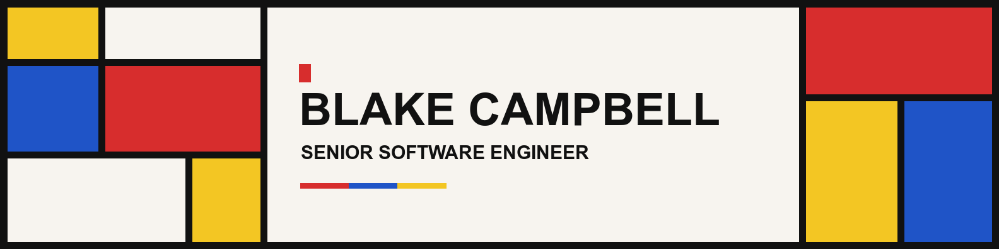

# Hi, I'm Blake

I'm a senior software engineer based in Pittsburgh with 10+ years building production software. I work across frontend development, backend services, testing, and delivery with React, Vue, TypeScript, Node.js, and Ruby on Rails.

Currently on contract with **Argonne National Laboratory**, modernizing legacy applications. Previously, I built chatbot analytics and review tools at **Apple** and co-founded **BenefitMany**, where I led an eight-person remote engineering team.

[Portfolio](https://blakecampbell.com/) · [LinkedIn](https://www.linkedin.com/in/blake-campbell/) · [Work and case studies](https://blakecampbell.com/work/)

## Selected experience

- **[Argonne National Laboratory](https://blakecampbell.com/work/argonne-national-laboratory/)** — Modernize 5+ legacy applications with React, TypeScript, and Rails. Build shared components and Playwright end-to-end tests, with release pipelines requiring at least 80% test coverage per application.
- **[Apple](https://blakecampbell.com/work/apple/)** — Built tools to explore and classify millions of chatbot conversations across 26 locales and seven languages. Worked with business and data science teams from design through delivery, including automated classification and human review workflows.
- **[BenefitMany](https://blakecampbell.com/work/benefitmany/)** — Co-founded a software consultancy for small businesses and nonprofits. Led an eight-person remote team through requirements, planning, development, and delivery of internal tools and customer-facing applications.

## Selected projects

- **[uses.tech](https://uses.tech/)** — Core maintainer since 2021 of an open-source developer directory with 1,000+ contributors. Review pull requests, handle issues, and keep entries current. [Source](https://github.com/wesbos/awesome-uses)
- **[Award Went To](https://awardwentto.com/)** — Built interactive Academy Awards visualizations, historical timelines, prediction sheets, and Oscar bingo with Nuxt, TypeScript, and Cloudflare. [Case study](https://blakecampbell.com/work/awardwentto/)
- **[SnapRemark](https://apps.apple.com/us/app/snapremark/id6738997529)** — Designed, built, and published a native iOS party game in Swift, taking it from an idea to the App Store. [Case study](https://blakecampbell.com/work/snapremark-ios-application/)
- **[AI Plays Pokémon](https://aiplayspokemon.com/)** — Train and evaluate reinforcement learning agents for Pokémon Red and Crystal with Python, PyBoy, and recurrent PPO. Track verified gameplay milestones and evaluate checkpoints on held-out seeds. [Case study](https://blakecampbell.com/work/ai-plays-pokemon/)

## Core stack

- **Frontend:** TypeScript, JavaScript, React, Vue, Nuxt, HTML, CSS, Tailwind CSS
- **Backend:** Ruby on Rails, Node.js
- **Testing:** Playwright, Jest, RSpec

For senior engineering opportunities, [connect with me on LinkedIn](https://www.linkedin.com/in/blake-campbell/).
